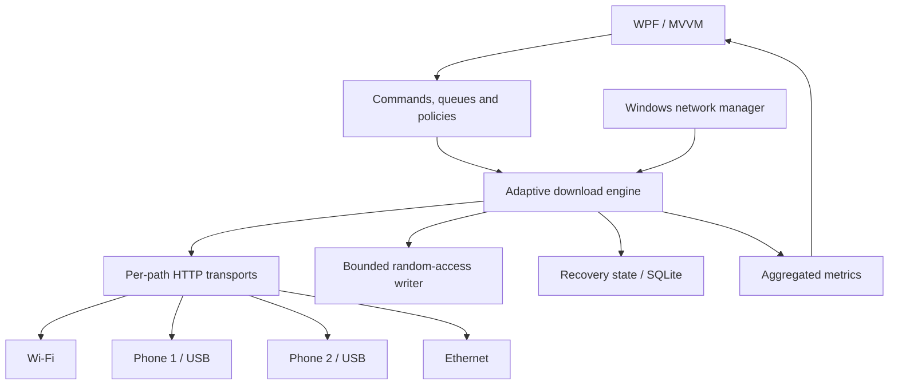

# Windows Multi-Internet Download Manager

## Approved product plan and agentic development contract

- Document version: 1.0
- Approval baseline: user-approved plan, 2026-11-14.
- Target: Windows 10 and Windows 11 desktop application.
- Initial architecture: x64. ARM64 and x86 are not baseline commitments.
- UI: WPF, English, modern Fluent-inspired appearance.
- Repository layout: production projects inside `application/`; no `src/` directory.
- Current deliverable: this specification only. Application development has not started.
- Product name: not selected. `DownloadManager` is a working technical name.

This document is self-contained. An implementation agent must not require the original conversation to understand the requirements. It records the approved scope, technical rules, delivery sequence, acceptance criteria, and unresolved implementation details.

The user approved the plan, but the current request is to document it. Do not interpret reading this document alone as an instruction to begin implementation. Once the user instructs an agent to implement the project, carry out the authorized phases without repeatedly requesting approval for routine reversible engineering decisions.

## 1. Product objective

Build an independent Windows download manager that downloads a file concurrently over multiple independently connected internet interfaces. Examples include home Wi-Fi, two phones connected through USB tethering, Ethernet, and USB network adapters.

The download engine owns file segmentation, request scheduling, interface selection, retries, persistence, and assembly. It must not depend on IDM. IDM is a feature reference, not an integration dependency or code source.

Primary outcomes:

1. Improve useful download throughput by using multiple internet paths simultaneously.
2. Dynamically split and redistribute unfinished byte ranges throughout a download.
3. Support more than eight concurrent requests and connections, with measured adaptive control.
4. Resume safely after pause, connectivity loss, application crash, and system restart.
5. Keep the interface simple while exposing advanced controls on demand.
6. Build toward an explicitly tracked IDM-like feature set in phases.
7. Keep memory, CPU, disk traffic, dependencies, and background activity bounded.

### 1.1 Explicit non-goals for the initial product

- MPTCP, VPS, Linux, WSL, and external aggregation servers.
- System-wide VPN, packet tunneling, and accelerating arbitrary application connections.
- Changing global Windows routing priorities as the download scheduling mechanism.
- Mandatory kernel drivers, traffic interception, TLS interception, or a background Windows service.
- Guaranteed aggregation on servers that reject ranges, enforce one source IP, or impose account-wide bandwidth limits.
- DRM bypass or a promise to support every website.

Ordinary HTTP range requests provide parallel downloads here. This is application-level multi-path downloading, not transparent bonding of one TCP connection.

## 2. Confirmed decisions and remaining technical validation

### 2.1 Confirmed by the user

- Standalone downloader rather than an IDM proxy.
- Windows 10 and Windows 11.
- English WPF interface with attractive, restrained animations.
- Multiple Wi-Fi, USB-tethering, and Ethernet internet paths where hardware permits.
- Dynamic segmentation and continuous reassessment during transfers.
- Configurable concurrency above eight.
- Full development roadmap toward IDM-like capabilities.
- Production code under `application/`, not `src/`.
- Finish the plan before implementing the application.

### 2.2 Engineering choices to validate, not reasons to block all work

- Use Windows 10 22H2 x64 and supported Windows 11 x64 versions as the initial test baseline; record exact builds. Older Windows 10 releases need separate validation.
- Product compatibility with Windows 10 is distinct from Microsoft OS lifecycle support. Check .NET runtime support for the exact target builds before release.
- Verify independent interface binding on real Windows hardware, including overlapping private networks and interface reconnects.
- Evaluate one maintained Fluent-style WPF component library for compatibility, license, accessibility, and footprint.
- Measure and tune buffer limits, segment sizes, concurrency caps, and adaptation intervals.
- Decide framework-dependent versus self-contained distribution using measured installation trade-offs.

Record routine decisions as short architecture decision records once implementation starts. Ask the user only when a choice changes approved scope, meaningful user behavior, external cost, or an irreversible action.

## 3. Repository layout

```text
/
├── application/
│   ├── App.Wpf/
│   ├── Core/
│   └── Infrastructure/
├── tests/
│   ├── Core.Tests/
│   ├── Integration.Tests/
│   └── TestServer/
├── docs/
│   ├── architecture/
│   ├── ux/
│   └── decisions/
├── DownloadManager.sln
├── Directory.Build.props
├── Directory.Packages.props
├── global.json
└── README.md
```

This tree describes future implementation; creating this specification does not require scaffolding the tree now. Test project names and the working solution name may be refined consistently.

### 3.1 Dependency direction

- `Core` contains domain models, scheduling algorithms, state transitions, policies, and infrastructure contracts.
- `Core` must not reference WPF, SQLite, Windows interop, or concrete HTTP implementation types.
- `Infrastructure` implements HTTP, Windows networking, persistence, disk access, and diagnostics contracts.
- `App.Wpf` is the composition root and contains views, view models, UI resources, navigation, and user commands.
- Keep the engine UI-independent and usable by headless tests.
- Prefer three production projects initially; split further only when a concrete boundary warrants it.

## 4. Technology baseline

| Concern | Baseline |
| --- | --- |
| Language/runtime | C# on .NET 10 LTS, pinned SDK and current servicing patches |
| Desktop UI | WPF |
| UI pattern | MVVM with CommunityToolkit.Mvvm |
| HTTP | HttpClient and SocketsHttpHandler |
| Interface selection | Small Windows interop layer and explicitly configured sockets |
| Persistent state | SQLite through a lightweight maintained provider |
| Asynchronous work | async/await, cancellation, bounded queues/channels |
| Credentials | Windows-protected storage, e.g. DPAPI or Credential Manager |
| Testing | Unit tests, controlled HTTP integration tests, real Windows acceptance tests |

Use one application process initially. Closing the main window may keep downloads running in the tray according to a visible setting. Explicit Exit must have defined behavior and persist recoverable progress. Downloads are not promised to survive process termination or user logout without later service work.

Avoid microservices, an embedded browser for the main UI, custom HTTP/TLS implementations, and generic frameworks without a clear need.

## 5. Runtime architecture



### 5.1 Ownership and threading

- One logical owner serializes changes to each download's range map and lease lifecycle.
- Network workers report progress and outcomes; they must not independently mutate shared scheduling state.
- Disk workers may write concurrently only to disjoint, currently owned extents.
- All queues have capacity limits and cancellation behavior.
- No network, disk, hash, database, or blocking wait work on the WPF dispatcher.
- The UI receives immutable or safely published snapshots at a bounded frequency.
- Cancellation is a normal lifecycle event and must be distinguished from transport failure.

## 6. Internet interface management

### 6.1 Discovery and identity

Discover interfaces, addresses, operational state, routes, and available connectivity information using maintained .NET and Windows APIs.

Maintain stable interface identity separately from current interface index, source addresses, and connection generation. Indices and IPs can change after reconnect or restart.

Each path records:

- Stable identity, current interface indices, and address family.
- Friendly name and optional user alias.
- Connection type and current usable source addresses.
- Operational and internet-reachability state.
- User enable/disable state.
- Observed throughput, errors, response delays, and current load.
- Concurrency, speed, and consumption limits.
- Metered/cost preference and session/accounting policy.
- Current generation, updated on address or connectivity changes.

A USB phone can appear as Ethernet. Do not rely on its display type alone. A normal Wi-Fi radio generally cannot connect to several independent SSIDs simultaneously; additional Wi-Fi adapters may be required.

### 6.2 Path state

```text
Detected -> Checking -> Ready
                         |
                         v
                      Degraded -> Offline

Additional states: Disabled, QuotaReached, NeedsAttention
```

- Link-up alone is not proof of internet access.
- Captive portals and destination-specific failure need distinct diagnostics where possible.
- Revalidate after DHCP changes, reconnect, sleep/wake, and network-change events.
- Use bounded, backoff-controlled health checks; avoid unnecessary data use.
- Do not run intrusive public speed tests automatically. Learn from downloads or an explicitly requested test.

### 6.3 Explicit egress selection

Create isolated HTTP transport pools per path generation and applicable origin/session policy. Reuse transports; do not create a new HttpClient for every byte range.

When establishing a TCP connection:

1. Resolve destination candidates under the defined DNS policy.
2. Select an available address family and source address on the chosen path.
3. Configure the appropriate Windows outgoing-interface socket option and local endpoint as required.
4. Connect and retain the original hostname for HTTP Host, TLS SNI, and certificate validation.
5. Verify the approach in the real-device networking spike.

`SocketsHttpHandler.ConnectCallback` is a candidate implementation hook for TCP-based HTTP. `IP_UNICAST_IF` / the IPv6 equivalent require correct native representation and address-family handling. Do not assume a single bind call guarantees all scenarios.

Never silently fall back to a disallowed interface. If selection cannot be enforced, fail that path safely and explain the limitation. Avoid global route changes by default. If a particular topology requires elevated changes, document the finding and seek a scoped decision instead of silently altering Windows networking.

On path-generation change, retire old transport pools and reject stale work. New connections must use current addresses.

### 6.4 DNS, IPv6, VPNs, and topology

- Default OS DNS resolution is not automatically independent per interface.
- Define resolver behavior, TTL caching, cancellation, and fallback explicitly.
- Use per-path resolution when needed and supported; preserve hostname-based TLS validation.
- Implement IPv4/IPv6 deliberately; never let address-family fallback defeat interface restrictions.
- Handle overlapping tethering subnets as a required real-device test.
- Existing third-party VPNs or security filters can change actual routing; detect/report limitations rather than bypassing them.
- Public egress-IP checks may assist diagnostics but do not replace packet-level or controlled-server validation.

## 7. Remote-resource probing and HTTP correctness

### 7.1 Probe sequence

1. Validate the URL scheme and request context.
2. Follow redirects under bounded, explicit rules.
3. Obtain useful metadata; HEAD is optional and not authoritative.
4. Issue a small real byte-range GET where appropriate.
5. Validate response status, Content-Range, size, and resource identity.
6. Check selected paths can access the same representation before combining their data.
7. Choose multi-path, single-path segmented, or sequential mode.

Support HTTPS with normal platform certificate validation. Never disable validation to make a download succeed.

### 7.2 Response handling

| Condition | Required behavior |
| --- | --- |
| Valid 206 | Confirm requested range boundaries, total size, identity, and expected body length |
| 200 after a range request | Do not write it into a segment offset; reassess identity/range support and select a safe mode |
| 416 | Reconcile size/range state; do not retry the same invalid request indefinitely |
| 429 / 503 | Respect Retry-After, apply backoff, reduce concurrency |
| 401 / 403 | Classify auth/link expiry where possible; do not infinite-retry |
| Redirect | Apply hop limits, validate target, strip credentials across unrelated origins |
| Truncated body | Commit only safely written progress and reschedule missing bytes |
| Changed representation | Stop combining old and new bytes |
| Unknown length / no ranges | Use a clearly identified sequential mode |

### 7.3 Content identity and sessions

- Record strong ETag where supplied, size, relevant Last-Modified information, and final URL metadata.
- Use If-Range according to HTTP semantics; weak ETags are not valid If-Range entity tags.
- A date is usable as an If-Range validator only under the standard's conditions.
- Size or filename alone is insufficient evidence that content is unchanged.
- Lack of reliable identity weakens resumability; use a conservative policy and describe it to the user.
- Avoid automatic decompression changing the byte representation used for ranges; request and validate a consistent representation.
- Cookie/auth state is separate from connection pools and must remain consistent across paths when required.
- Servers may bind URLs or sessions to one IP; offer a per-download or per-site single-path policy.
- POST downloads are not automatically safe to replay or segment; initially restrict segmentation to validated, repeatable GET resources.
- Do not merge multiple mirrors based on names or size alone. Require trusted content identity.

### 7.4 Protocol versions

- Begin with HTTP/1.1 for predictable connection control and routing validation.
- Model physical connections and concurrent requests separately from the outset.
- Add HTTP/2 after correctness is established; multiplexed streams are not independent TCP connections.
- HTTP/3 is deferred because QUIC routing and binding need a separate transport design; ConnectCallback does not control HTTP/3 connections.

## 8. Dynamic byte-range scheduler

### 8.1 Range model

Internally represent intervals as half-open `[start, end)` using 64-bit offsets. Convert carefully to HTTP's inclusive byte-range syntax at the boundary.

Maintain completed intervals, pending intervals, and leased active intervals. Adjacent intervals may be coalesced. Do not persist or display a rigid initial partition as the source of truth.

Required invariants:

1. Completed, pending, and active work represent a consistent file range without unexplained holes.
2. No writable byte is simultaneously owned by two live leases.
3. Committed completed bytes are not allocated again except during explicit recovery/revalidation.
4. Stale lease generations cannot write to reassigned regions.
5. Progress counts unique accepted bytes, not retries or overlapping network traffic.
6. Every response is validated before its payload is accepted at a file offset.

### 8.2 Allocation

Workers request new work from a shared logical range pool. Faster paths finish sooner and naturally claim more work. Do not divide the file into one permanent large portion per internet connection.

Initial estimate:

```text
target_range_bytes = estimated_worker_bytes_per_second * target_duration_seconds
```

Clamp by configured minimum/maximum size, file remainder, server behavior, and disk pressure. An initial 2-5 second target is a tuning hypothesis, not a release promise. Distinguish worker throughput from aggregate path throughput when several workers share a path.

Avoid eagerly creating thousands of tiny range records. Carve work from remaining intervals when needed.

### 8.3 Feedback control

Use smoothed recent throughput, error rate, stalled-read time, remaining bytes, and available capacity. Probe concurrency cautiously and avoid changing concurrency and segment sizing aggressively in the same observation window.

Initial cadence hypotheses:

- Collect bounded metrics every few hundred milliseconds.
- Run periodic adaptation approximately every 1-2 seconds.
- React immediately to completion, path loss, cancellation, and meaningful resource changes.
- Apply hysteresis, minimum lease sizes, and cooldowns to avoid churn.

These values must be measured and revised in benchmarks.

### 8.4 Splitting active work

An already-issued HTTP Range cannot be modified at the server. To redistribute an unfinished tail:

1. Estimate whether the expected time saved exceeds cancellation/reconnect/duplicate-byte costs.
2. Establish a new local stop boundary or cancel the old transfer.
3. Stop or drain in-flight writes under the old lease.
4. Commit the known accepted prefix conservatively.
5. Invalidate or narrow the old lease and create new non-overlapping work.
6. Assign the remainder to available paths.

Worker generation fencing and the write boundary must be enforced before another worker owns the region. Discard late data beyond the valid boundary. Do not mark network-received bytes as disk-completed prematurely.

### 8.5 Endgame policy

As the file nears completion, reduce allocation size and balance estimated completion times. Reassign genuinely stalled tails where worthwhile. Avoid blanket speculative duplication; any later duplicate-request optimization needs an explicit bandwidth budget and correctness tests.

## 9. Connection and concurrency management

Support more than eight requests without hard-coding a small partition count. Apply coordinated limits at:

1. Application level.
2. Origin/service level across all downloads.
3. Download level.
4. Interface/path level.

Reserve capacity atomically when scheduling, including work connecting but not yet active. This prevents simultaneous workers all choosing an apparently idle path.

User profiles:

- `Auto`: measured adaptive concurrency.
- `Custom`: explicit caps and path preferences, within resource safety bounds.
- `Conservative`: lower server pressure and slower ramp-up.

Initial benchmark cases include 16, 32, and 64 concurrent requests, with a provisional application-wide cap of 128. These are test configurations, not universally optimal defaults. More connections must not be advertised as inherently faster.

Auto mode starts small, increases gradually, measures useful throughput, and backs off when errors or congestion increase without useful gain. Respect server-wide limits, Retry-After, and per-account behavior where known.

Provide fair allocation across downloads, priority support, and starvation prevention. A single file must not monopolize every transport slot unless the user explicitly selects such a policy.

Connection reuse and keep-alive are required where appropriate. Do not create a new TLS session for every small segment. Cancellation may make some HTTP/1.1 connections non-reusable; account for that cost.

## 10. Failure handling and policy

Classify failures rather than retrying everything identically:

| Class | Policy |
| --- | --- |
| Path offline/address changed | Retire old pool, reschedule missing work on allowed ready paths |
| Temporary network/read error | Bounded retry with exponential backoff and jitter |
| Server pressure | Respect server delay and reduce load |
| Resource/auth expired | Pause for renewed context or supported refresh flow |
| Content changed | Prevent mixed output; restart or user-visible resolution |
| Disk full/access denied/device removed | Stop writing safely; preserve resumable state |
| User pause/cancel | Normal lifecycle transition, not a health penalty |
| Integrity failure | Do not label complete; retain diagnostics and recovery options |

Use separate connect, response-header, inactivity, and retry-budget policies. A long legitimate download must not fail because of one arbitrary short whole-request timeout.

Do not migrate a live TCP connection between internet paths. Recover by issuing new validated range requests for missing bytes.

## 11. File writing, persistence, and crash recovery

### 11.1 Writer

- Write directly to offsets in a temporary destination file; avoid one physical file per segment.
- Prefer temporary data on the destination volume to avoid a full-file final copy.
- Use bounded pooled buffers and backpressure.
- Preallocation is optional and must respect filesystem behavior and disk availability.
- Handle unsupported large-file filesystems and capacity errors clearly.
- Sanitize server-supplied filenames and prevent path traversal/reserved-name issues.
- Define collision behavior: rename, replace with confirmation when appropriate, or cancel.

### 11.2 Durable checkpoints

Maintain metadata in SQLite with versioned migrations and a documented durability configuration. WAL alone does not guarantee correct file/metadata ordering.

Checkpoint sequence:

1. Write accepted payload bytes.
2. Flush/checkpoint file data at a defined durability boundary.
3. Persist corresponding durable completed intervals transactionally.

After an abnormal exit, uncertain ranges are redownloaded rather than trusted. An interrupted checkpoint may lose some recent progress but must not silently corrupt the output.

Batch checkpoints to balance disk overhead and recoverable progress. Handle metadata corruption conservatively; a temporary file without trustworthy range metadata must not be assumed complete.

### 11.3 Completion and verification

- Ensure all bytes are durably accounted for and no active writer remains.
- Check total size and protocol-level consistency.
- Compare an authoritative checksum when supplied by the source or user.
- Local checksums support recovery/corruption detection but do not independently establish source authenticity.
- Rename/finalize only after successful completion checks.
- Cross-volume moves, if requested, are a separate recoverable operation, not an assumed atomic rename.

## 12. Domain models and state machines

| Model | Key responsibilities |
| --- | --- |
| DownloadJob | Request reference, destination, priority, policy, status |
| RemoteResource | Size, representation validators, redirects, range capability |
| NetworkPath | Stable identity, current generation, addresses, health, limits |
| RangeMap | Completed, pending, active coverage |
| RangeLease | Owner, generation, permitted boundary, progress |
| TransferAttempt | Path, timings, response classification, outcome |
| DownloadQueue | Ordering, schedule, concurrency and consumption policy |
| CredentialReference | Reference to protected secrets, not plaintext secrets |
| DownloadSnapshot | Immutable UI-facing status and metrics |

Representative job lifecycle:

```text
Queued -> Probing -> Downloading -> Verifying -> Completed
                        |
                        v
                      Paused -> Resuming -> Downloading

Additional states:
WaitingForNetwork, RetryScheduled, NeedsAuthentication,
NeedsResourceRefresh, StorageBlocked, Failed, Cancelled
```

Define allowed transitions explicitly. Pause preserves recoverable data. Cancel and delete are separate actions, with clear choices about keeping partial files.

## 13. Feature roadmap toward IDM parity

IDM-like scope means a tracked capability matrix. It does not mean copying branding or promising all-site compatibility.

| Capability | Delivery stage |
| --- | --- |
| HTTP/HTTPS direct download | Engine baseline |
| Dynamic range splitting and multiple internet paths | Engine baseline |
| Configurable/adaptive concurrency above eight | Engine baseline |
| Pause/resume, reconnect, crash recovery | Engine baseline |
| Per-path speed, usage, health and enable/disable | Engine baseline / base UI |
| Multiple downloads, priority and queues | Base product |
| Search, history, categories, automatic destination rules | Base product |
| Global, per-download and per-path speed limits | Base product |
| Metered path quotas and consumption preferences | Base product |
| Schedules, recurring queue windows and sleep/wake handling | Base product |
| Completion notifications and optional configured actions | Base product |
| Batch import/export, duplicate detection, drag and drop | Base product |
| Optional clipboard-link detection | Base product |
| Authentication and proxy configuration | Infrastructure baseline, expanded later |
| Edge/Chrome/Firefox browser extensions | Browser integration |
| Download capture with required session context | Browser integration |
| Refresh expired download address safely | Browser integration |
| Non-DRM media capture on explicitly supported sites | Media module |
| HLS/DASH manifests, track handling and optional muxing | Media module |
| FTP/FTPS | Advanced protocol module |
| Site Grabber with filters, scope and crawl limits | Advanced module |
| Periodic file/site synchronization | Advanced module |
| Optional installed-antivirus integration | Advanced module |

SFTP is distinct from FTP/FTPS and requires a separate scope decision. Multiple-mirror download acceleration also requires a separate identity-verification design.

### 13.1 Browser integration rules

- Prefer browser extensions and native messaging over system-wide traffic interception.
- Request only required extension permissions and make capture opt-in/configurable.
- Never assume every browser download is a replayable GET URL.
- Securely transfer the minimum request context needed; do not export the entire browser cookie store.
- Refreshing a URL must revalidate content identity before resuming old bytes.
- Explicitly list tested sites/flows and known limitations.

### 13.2 Media and advanced scope

Treat adaptive media as a distinct pipeline: manifest parsing, segment identities, track ordering, encryption where legitimately supported, and packaging. Do not force it into ordinary byte-range logic.

If media packaging introduces an external executable or substantial dependency, evaluate license, distribution size, updates, and sandbox/process behavior before adoption.

## 14. WPF user experience

### 14.1 Main layout

```text
+--------------------------------------------------------------------+
| App       + Add Download            Search                 Settings |
+--------------+-----------------------------------------------------+
| All          | File              Progress        Speed       ETA   |
| Downloading  | Archive.zip       64%             12 MB/s     2m    |
| Queued       | Video.mp4         Queued                            |
| Completed    | Document.pdf      Completed                         |
|              |                                                     |
| Connections  |                                                     |
| Scheduler    |                                                     |
+--------------+-----------------------------------------------------+
| Phone 1: 6 MB/s     Phone 2: 4 MB/s     Wi-Fi: 2 MB/s               |
+--------------------------------------------------------------------+
```

Default add flow: `Add Download -> Validate link -> Choose destination -> Start`.

Default network policy: `Auto - Selected Connections`. Expose path selection and deeper settings through `Advanced`, not mandatory setup dialogs.

Download details tabs:

- `Overview`: progress, useful speed, size, ETA and resumability.
- `Connections`: path contributions, status and current load.
- `Segments`: throttled visualization of current range state.
- `Activity`: readable events, errors and next action.

The Connections screen shows friendly path cards with enable/disable, alias, current speed, download-manager usage, quota and limits. Do not imply application accounting is the operator's billing meter or all-device traffic accounting.

### 14.2 Visual and motion requirements

- Fluent-inspired controls, coherent icons, light/dark/system themes.
- Restrained accent color, consistent spacing and readable typography.
- Short panel transitions, state changes, and completion animation.
- No permanent decorative animation or per-packet UI updates.
- Smooth charts from aggregated samples; bounded history.
- Respect reduced-motion settings, high contrast, keyboard navigation and screen readers.
- Support common DPI scaling and window sizes on Windows 10 and 11.
- Do not rely on Windows 11-only visual effects for essential usability.
- Use text/icons alongside color to convey status.
- Show unknown progress as indeterminate, never fabricated percentages.
- Pause offscreen animations and virtualize download lists.

### 14.3 UI language and clarity

- All initial product strings are English.
- Put user-visible strings in resources for future localization.
- Use understandable errors with an action: retry, choose another path, refresh link, free disk space.
- Default UI shows useful unique payload speed. Advanced metrics may separately show network overhead/retries.
- Label MB/s and Mbps unambiguously; do not mix units silently.
- Technical socket errors belong in expandable diagnostics, not primary user flows.

## 15. Performance, privacy, and security rules

- Bounded memory independent of total file size.
- No whole-file buffering, unbounded task spawning, or unbounded chart/log history.
- Reuse buffers and connections where appropriate.
- Apply backpressure when disk or metadata persistence falls behind.
- Log rotation and redaction are mandatory.
- Never log full signed URLs, cookies, authorization headers, or credentials.
- Protect persisted secrets with Windows facilities; exclude them from exports and diagnostics by default.
- Do not execute downloaded files automatically.
- Certificate validation remains enabled.
- Clipboard observation, browser capture, startup launch, telemetry, and external diagnostics must be explicit and controllable; no analytics dependency is required.
- Apply filename/path validation to remote input and exported/imported data.
- Completion shutdown/sleep actions require a user-enabled policy and must be cancellable.
- Updates and distribution need integrity validation; publishing is not authorized merely by implementing an updater.

Measure CPU, working set, idle activity, write amplification, cancellation overhead, and useful throughput before setting final budgets. Do not make unsupported claims about footprint or acceleration factors.

## 16. Test strategy and acceptance matrix

### 16.1 Unit tests

- Interval split/coalesce and half-open/inclusive conversions.
- No holes, double ownership, stale writes, or double-counted progress.
- Lease cancellation and generation fencing.
- Adaptive policies with a deterministic clock and simulated metrics.
- Limits, fairness, backoff and retry classification.
- State-machine transitions and recovery metadata reconciliation.

Use randomized/property-style interval tests where they expose meaningful edge cases; tests must not merely duplicate implementation details.

### 16.2 Controlled integration server

Provide configurable endpoints for valid/malformed ranges, unsupported ranges, changing ETags, slow/stalled bodies, abrupt disconnects, redirects, expired auth, throttling, and variable response sizes.

Bind multi-path test transfers to the same representation and compare final output with an authoritative fixture hash.

### 16.3 Real Windows acceptance

| Scenario | Acceptance criterion |
| --- | --- |
| Windows 10 and Windows 11 | Build/install/run and core flows validated on both |
| Two USB phones plus Wi-Fi | Actual independent traffic on selected paths |
| Overlapping private subnets | Routing validated or clear supported-topology limitation documented |
| Unequal path speeds | Faster paths receive more useful work over time |
| 16/32/64 requests | Correct output, bounded resources, responsive UI |
| Disconnect one phone | Missing ranges recovered without silent corruption |
| Reconnect with changed IP | New path generation and safe pool recreation |
| Slow final segment | Endgame policy improves or safely bounds avoidable tail delay |
| 200 for Range / malformed 206 | No wrong-offset writes |
| Changed file on resume | No mixing of resource versions |
| 429 / 503 | Retry-After respected and concurrency reduced |
| Crash or forced termination | Conservative resume from trustworthy checkpoints |
| Disk full / external disk removed | Safe stop with actionable recovery |
| File larger than 4 GiB | Correct offsets and final hash |
| Sleep/wake and network change | Correct revalidation and recovery |
| IP-bound server | Clear single-path fallback/policy |

### 16.4 Benchmark method

- Use the same resource and server conditions for single-path and aggregate runs.
- Measure each path alone, then all selected paths together.
- Report useful unique bytes per second, complete wall-clock time, retry overhead and resource usage.
- Include controlled-server tests to separate engine limitations from public-server caps.
- Do not require perfect sum-of-links speed on arbitrary networks.
- A passing aggregation demonstration shows simultaneous true path use and shorter completion time than the fastest individual path in a suitable controlled scenario.

Linux-based tooling can test platform-neutral logic and HTTP behavior. It cannot certify WPF, Windows interop, real interface binding, or Windows installation. Report such verification as pending until performed on Windows.

## 17. Phased implementation plan

### Phase 0 - Design baseline

Deliverables: this specification, initial architecture decisions, model contracts, UI wireframes, compatibility matrix, and feature checklist.

Exit gate: approved scope is represented; unknowns are recorded without false guarantees. No application implementation is implied by the documentation-only request.

### Phase 1 - Networking proof

Deliverables: minimal Windows test harness for interface discovery, explicit egress, isolated pools, reconnects, IPv4/IPv6 handling and destination checks.

Exit gate: prove actual independent path use on target hardware. Do not build the full visual shell as a substitute for this proof.

### Phase 2 - Correct single-path engine

Deliverables: resource probing, validated range requests, direct offset writing, sequential fallback, pause/resume and basic metadata.

Exit gate: correct output and response handling under controlled-server failures.

### Phase 3 - Adaptive multi-path engine

Deliverables: shared interval pool, leases, dynamic sizing/splitting, path scheduling, adaptive concurrency and fairness.

Exit gate: independent path use, measured aggregation, safe disconnection recovery, and interval invariant tests.

### Phase 4 - Durable recovery

Deliverables: checkpoints, migrations, crash recovery, file/device failure handling and finalization.

Exit gate: forced interruption does not cause silent corruption or false completion.

### Phase 5 - WPF base product

Deliverables: English UI, queues, settings, connection management, charts, segment visualization, tray, accessibility, base scheduling and installer evaluation.

Exit gate: core workflows and installation validated on Windows 10 and 11; UI remains responsive under load.

### Phase 6 - Browser integration

Deliverables: extensions, native messaging, controlled capture, request context handling and address refresh.

Exit gate: supported browser flows are enumerated and verified; secrets handled safely.

### Phase 7 - Advanced features

Deliverables: individually accepted media support, FTP/FTPS, Site Grabber, synchronization and remaining parity items.

Exit gate: each module has independent compatibility, correctness and footprint evidence. Do not delay the base product until all advanced features exist.

Estimate phase durations after the networking and engine spikes. Do not invent a fixed schedule before their uncertainties are measured.

## 18. Rules for agentic implementation

### 18.1 Before editing

1. Read applicable repository instructions and this document.
2. Inspect existing files and working-tree changes; preserve unrelated work.
3. Identify the currently authorized phase and its exit gate.
4. Check actual SDK, OS and available test capabilities before selecting commands.
5. Use targeted searches and bounded output; do not dump secrets or entire dependency trees.

### 18.2 During implementation

- Deliver coherent vertical slices, not a large unreviewable scaffold.
- Follow the phase order unless a dependency justifies a documented adjustment.
- Keep production code in `application/`; never introduce `src/`.
- Use English for source identifiers, comments, UI strings and technical documentation.
- Enable nullable reference types and use analyzers appropriate to the project.
- Keep interface contracts small and domain names explicit.
- Propagate cancellation and use async I/O end-to-end.
- Do not block the dispatcher with Result, Wait, sleeps or long operations.
- Avoid async void except genuine UI event handlers.
- Bound retries, tasks, queues, connections, logs and buffers.
- Add dependencies only for a clear need; review maintenance, license and footprint.
- Do not write a custom TLS stack or reimplement HTTP framing unnecessarily.
- Do not refactor unrelated areas as part of a feature.
- Do not create service/driver infrastructure without a demonstrated need and scope decision.
- Never weaken correctness invariants to show a higher benchmark number.
- Do not spawn additional agents unless the user or applicable repository instructions explicitly authorize delegation.

### 18.3 Validation and reporting

- Test changed behavior at the right level and run applicable checks.
- For network changes, verify failure paths as well as the happy path.
- Clearly separate tested facts, simulations, hypotheses and Windows-only checks still pending.
- Never claim success based only on a build or mocked routing.
- Document meaningful decisions, known limitations and exact reproduction steps.
- Keep this plan/checklist aligned with the implementation; major scope changes need explicit user direction.
- Report what changed, why, how it was verified, and any blocker that remains.
- Do not repeatedly rerun broad tests without a change or unresolved concern.

### 18.4 Permissions and external actions

Routine authorized local implementation and reversible fixes do not need repeated confirmation. Do not use this plan as authorization to purchase infrastructure, modify user-global network settings, publish extensions/releases, deploy externally, send messages, or delete unrelated data.

Complete the concrete reviewable work before requesting approval for an action that actually requires it. State the exact blocker if permissions or the environment prevent verification.

### 18.5 Definition of done for a phase

- Deliverables implemented within the phase scope.
- Relevant acceptance criteria pass with recorded evidence.
- No known corruption, stale-writer or unintended-route defect left unresolved.
- Meaningful tests and diagnostics accompany behavior changes.
- Documentation reflects actual behavior, not aspirational features.
- Unverified hardware/OS cases are explicitly identified.
- No unrelated changes, secrets, generated junk or unbounded dependencies included.

## 19. Initial backlog for an implementation agent

The list is intentionally unchecked; this document does not claim application work has been completed.

- [ ] Confirm minimum Windows builds and SDK/runtime compatibility.
- [ ] Create the approved solution layout under `application/` after implementation is authorized.
- [ ] Record interface-routing and DNS design decisions.
- [ ] Prove independent egress on real Windows hardware.
- [ ] Define interval and lease invariants in executable tests.
- [ ] Build the controllable HTTP test server.
- [ ] Implement validated single-path range downloading.
- [ ] Add bounded direct-offset writing and conservative checkpoints.
- [ ] Add multi-path scheduling and more-than-eight request support.
- [ ] Add adaptive range sizing, active-tail redistribution and endgame policy.
- [ ] Validate retries, reconnects, quotas and server pressure handling.
- [ ] Verify crash recovery and authoritative fixture hashes.
- [ ] Build English WPF workflows and connection cards.
- [ ] Validate responsive UI, DPI and reduced motion on Windows 10/11.
- [ ] Add base-product queues, scheduling and management features.
- [ ] Add browser integration with a documented compatibility list.
- [ ] Implement advanced parity features as separate accepted slices.

## 20. Reference documentation

Use current primary documentation during implementation. These references explain APIs and protocol rules, not proof that the planned application has been tested.

- [.NET support policy](https://dotnet.microsoft.com/en-us/platform/support/policy)
- [.NET releases and support](https://learn.microsoft.com/en-us/dotnet/core/releases-and-support)
- [SocketsHttpHandler.ConnectCallback](https://learn.microsoft.com/en-us/dotnet/api/system.net.http.socketshttphandler.connectcallback?view=net-10.0)
- [Windows IPPROTO_IP socket options](https://learn.microsoft.com/en-us/windows/win32/winsock/ipproto-ip-socket-options)
- [Windows network interfaces](https://learn.microsoft.com/en-us/windows/win32/network-interfaces)
- [RFC 9110: HTTP Semantics](https://www.rfc-editor.org/rfc/rfc9110.html)
- [IDM feature reference](https://www.internetdownloadmanager.com/features2.html)
- [IDM segmentation and general capabilities](https://www.internetdownloadmanager.com/support/about.html)
- [IDM scheduler reference](https://www.internetdownloadmanager.com/articles/scheduler.html)

## 21. Handoff instruction

When the user authorizes development, begin with the earliest incomplete phase. First establish the repository and environment facts, then prove Windows interface routing. Do not begin with decorative UI work, a VPN implementation, or a fixed eight-part downloader. The central deliverable is a correct, recoverable, dynamically scheduled multi-internet download engine with a straightforward English WPF interface.
